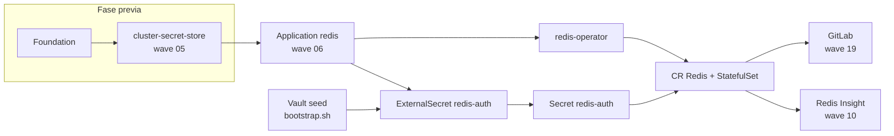

# Redis – Caché y colas compartidas (standalone)

Redis standalone compartido de `data-services`, gestionado por el **Redis Operator de OT-CONTAINER-KIT** y desplegado como componente GitOps (Application `redis`, **wave 06**). Lo consumen **GitLab** y futuros microservicios.

> **ArgoCD no usa este Redis.** ArgoCD despliega su propio Redis embebido (subchart `redis` de `argo-cd`) dentro del namespace `argocd`, con password generada por el Job `argocd-redis-secret-init` del propio chart.

## Tabla de Contenidos

- [1. Propósito y decisión técnica](#1-propósito-y-decisión-técnica)
- [2. Datos del despliegue](#2-datos-del-despliegue)
- [3. Dependencias](#3-dependencias)
- [4. Comunicación](#4-comunicación)
- [5. Secretos](#5-secretos)
- [6. TLS](#6-tls)
- [7. NetworkPolicies activas](#7-networkpolicies-activas)
- [8. Métricas](#8-métricas)
- [9. Acceso](#9-acceso)
- [10. Troubleshooting](#10-troubleshooting)
- [11. Evolución a alta disponibilidad](#11-evolución-a-alta-disponibilidad)

---

## 1. Propósito y decisión técnica

**Redis standalone** (no `RedisCluster`) porque:

- **GitLab no es compatible con Redis Cluster**: las operaciones multi-clave (sesiones, caché) fallan con `CROSSSLOT`.
- **Menos recursos** que un cluster; suficiente para el laboratorio.
- El operador permite migrar a `RedisReplication`/`RedisCluster` como evolución futura (ver §11).

El trade-off aceptado: GitLab y los microservicios comparten un único punto de fallo. La mitigación es la evolución a réplicas (§11) o un segundo CR `Redis` dedicado.

## 2. Datos del despliegue

| Propiedad | Valor |
|-----------|-------|
| Componente | `k8s/platform/components/data-services/redis/` |
| Application | `k8s/bootstrap/03-platform-orchestration/06-redis.yaml` |
| Sync wave | **06** (tras `cluster-secret-store`, antes de Redis Insight y GitLab) |
| Namespace | `data-services` |
| Charts | `ot-helm/redis-operator` **0.27.0** + `ot-helm/redis` **0.16.9** |
| Pod Redis | `redis-0` (StatefulSet), labels `app: redis`, `redis_setup_type: standalone` |
| Servicio | `redis.data-services.svc.cluster.local:6379` |
| Persistencia | PVC 3Gi (`appendonly` AOF) |
| Recursos | requests 100m/256Mi – limits 250m/500Mi (Redis); 100m/128Mi – 200m/256Mi (operador) |

Los manifests los genera `kustomize build --enable-helm` sobre `helmCharts` (mismo patrón que PostgreSQL/CNPG); **no hay manifests manuales del servidor**.

## 3. Dependencias

- `cluster-secret-store` (wave 05) debe estar listo para que `redis-es.yaml` sincronice.
- El password se siembra en Vault por `bootstrap.sh` (`vault_seed_kv`, idempotente).
- El CR `Redis` lleva `sync-wave: "1"` + `SkipDryRunOnMissingResource` (`redis-argocd-patch.yaml`) porque su CRD llega en el mismo sync.

## 4. Comunicación

| Origen | Destino | Puerto | Protocolo | Política |
|--------|---------|--------|-----------|----------|
| `redis-operator` (data-services) | kube-apiserver / `host` | 443, 6443, 8443 | TCP | `redis-operator-bootstrap` |
| `redis-operator` | `redis-0` | 6379 | TCP | `redis-operator-bootstrap` + `redis-bootstrap` |
| GitLab `app.kubernetes.io/instance: gitlab` + `app: webservice` / `sidekiq` / `migrations` (repositories) | `redis-0` | 6379 | TCP | `redis-bootstrap` (regla 2) |
| Redis Insight `app.kubernetes.io/name: redis-insight` (data-services) | `redis-0` | 6379 | TCP | `redis-bootstrap` (regla 3) |
| Prometheus (monitoring) | exporter | 9121 | TCP | `redis-metrics` ServiceMonitor |

> `default-deny-all` de `data-services` deniega cualquier otro flujo.

## 5. Secretos

| Secreto | Origen | Clave | Consumidor |
|---------|--------|-------|------------|
| `redis-auth` (data-services) | ExternalSecret `redis-es.yaml` ← `secret/data/platform/databases/redis` (`password`) | `password` | CR `Redis` (`redisStandalone.redisSecret`) |
| `gitlab-redis-auth` (repositories) | ExternalSecret `gitlab-redis-es.yaml` ← **mismo path** | `password` | GitLab webservice/sidekiq |
| `argocd-redis` (argocd) | Generado por el chart argo-cd (Job `redis-secret-init`) | `auth` | Solo ArgoCD |

La rotación se hace en Vault; ESO propaga en ≤15m (`refreshInterval`) y el operador/GitLab deben reiniciarse para tomar el nuevo valor.

## 6. TLS

Sin TLS en dev (igual que el resto de la plataforma). La auth es `requirepass`.

## 7. NetworkPolicies activas

| Política | Archivo | Función |
|----------|---------|---------|
| `redis-operator-bootstrap` | `redis-operator-network-policy.yaml` | Egress del operador → apiserver/host y → redis-0 |
| `redis-bootstrap` | `redis-network-policy.yaml` | Ingress a redis-0: operador + GitLab (`app.kubernetes.io/instance: gitlab` + `webservice`/`sidekiq`/`migrations`, desde repositories) + Redis Insight — patrón Vault: el CNP declara todos sus consumidores |
| `redis-insight-bootstrap` | `redis-insight-network-policy.yaml` | Egress de Redis Insight → redis-0:6379 |
| `redis-insight` | `config/redis-insight/redis-insight-network-policy.yaml` | Ingress a Redis Insight:5540 solo desde Traefik (networking) |

## 8. Métricas

`serviceMonitor.enabled: false` en values; el scrape lo define `config/redis/redis-service-monitor.yaml` (`redis-metrics`, endpoint `http-metrics` cada 30s, label `release: prometheus`).

## 9. Acceso

- **Cliente**: `kubectl port-forward -n data-services svc/redis 6379:6379` y `redis-cli -a "$(kubectl get secret redis-auth -n data-services -o jsonpath='{.data.password}' | base64 -d)"`.
- **UI**: Redis Insight (dentro del componente `redis`, wave 06; exposición en `config/redis-insight/`) en `https://redis-insight.dev.lab`.

## 10. Troubleshooting

| Síntoma | Causa probable | Acción |
|---------|----------------|--------|
| `redis-auth` no existe / ES `SecretSyncedError` | Path ausente en Vault o `cluster-secret-store` no listo | `kubectl describe externalsecret redis-auth -n data-services`; verificar `vault kv get secret/platform/databases/redis` |
| CR `Redis` no aparece | CRD aún no registrado (mismo sync) | Normal: wave 1 + SkipDryRun; esperar al reintento de ArgoCD |
| GitLab sin conexión a Redis | Pod sin `app.kubernetes.io/instance: gitlab` o `app:` distinto de `webservice`/`sidekiq`/`migrations` (regla 2 de `redis-bootstrap`) | `kubectl get pod -n repositories --show-labels`; comparar con la CNP |
| `redis-0` no arranca | Secret/auth o PVC | `kubectl describe pod redis-0 -n data-services`; logs del operador |
| App `redis` Degraded en ArgoCD | Sync parcial | `argocd app get redis`; `kubectl get ciliumnetworkpolicies -n data-services` |

## 11. Evolución a alta disponibilidad

Dos caminos, ambos cambios de values/CR (no de arquitectura):

- **RedisReplication + Sentinel** (charts `ot-helm/redis-replication` + `ot-helm/redis-sentinel`): réplicas con failover; GitLab sigue apuntando a un único Service → compatible.
- **Segundo CR `Redis` dedicado a GitLab**: separa dominios de fallo por consumidor con el mismo operador.

`RedisCluster` queda descartado mientras GitLab sea consumidor (limitación `CROSSSLOT`).
